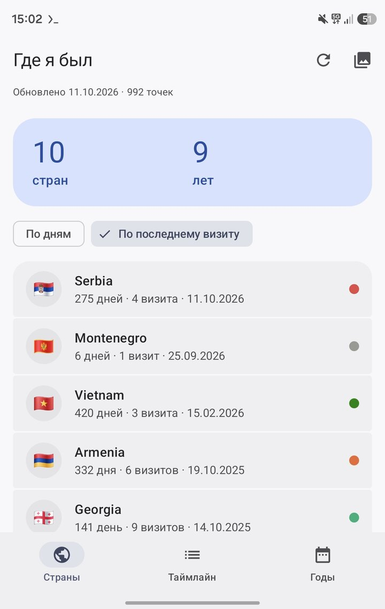
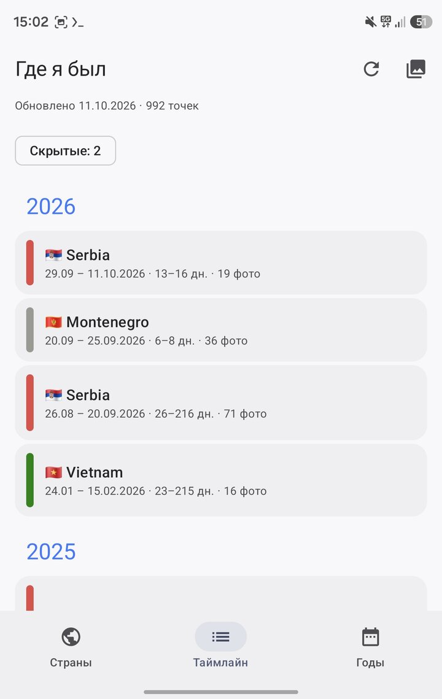
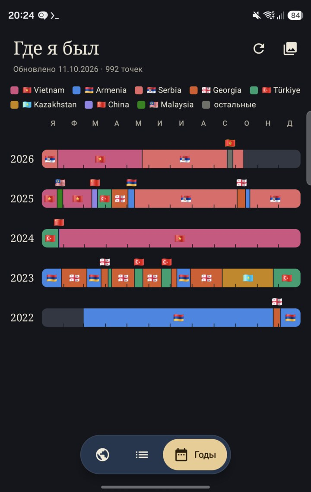

# Where I've been

An app that works out which countries you have been to and how many days you spent in each — from the
time and geotags of your photos

- **Sources:** Yandex Disk and/or the phone gallery (at least one is required, the other can be added later).
- **Countries:** a list of countries with total days and number of visits; tap a country to see its trips
  and the photos of each.
- **Timeline:** stays grouped by year; transits and short visits are marked. Tap a stay to open a sheet with
  its photos by day; stays that come from someone else's photos can be hidden from there.
- **Years:** each year as a strip of days coloured by country; tap a country to see the dates and length of
  the stay, tap that label to open the same sheet.
- **Photos:** tap a thumbnail to view it full screen — swipe sideways to page, pinch or double-tap to zoom,
  swipe up or down to close.

| Countries | Timeline | Years |
|---|---|---|
|  |  |  |

Only the capture time and coordinates are read. Photos are never sent anywhere; reduced previews are fetched
from the disk only when you open a stay or a country.
The country is resolved on the device using [Natural Earth](https://www.naturalearthdata.com/) polygons.

## Build

Kotlin Multiplatform + Compose Multiplatform: Android and desktop (JVM). Requires JDK 21 and the Android SDK
(`sdk.dir` in `local.properties`).

```sh
./gradlew :shared:jvmTest              # tests
./gradlew :androidApp:assembleDebug    # APK: androidApp/build/outputs/apk/debug/
./gradlew :shared:run                  # desktop (Yandex Disk only, sign in by pasting a token)
```

The release build (`assembleRelease`) is signed with the debug key for now.

## Layout

- `shared/` — all the code: `core` (points, countries, timeline), `yandex` (Disk API, OAuth), `gallery` (MediaStore),
  `data` (file storage), `ui` (screens).
- `androidApp/` — the Activity, manifest and resources.
- `prototype/` — the original Python prototype and the polygon packer `pack_countries.py`.

Yandex sign-in uses the OAuth implicit flow with a redirect to `photocountries://auth`. The client ID lives in
`shared/.../yandex/OAuth.kt`; it is public, the client has no secret.
